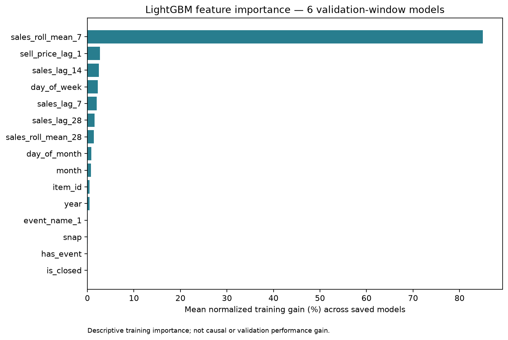

# Tuần 3 — LightGBM, đánh giá validation và đặc trưng

## Kết luận chính

Đã triển khai LightGBM dự báo điểm, kiểm tra rò rỉ dữ liệu, ghi thí nghiệm
bằng MLflow và so sánh với bảy cách dự báo tuần 2 trên cùng sáu cửa sổ
validation. LightGBM đạt RMSSE trung bình 0,694558, xếp thứ ba sau ETS
(0,673912) và trung bình trượt 28 ngày (0,677792). Kết quả hiện tại chưa
chứng minh LightGBM tốt hơn hai baseline mạnh nhất. Đây là kết quả validation;
chưa đánh giá LightGBM trên test và chưa tính chi phí tồn kho.

## Dữ liệu và đặc trưng

Giữ nguyên tập con tuần 1–2: 297 chuỗi FOODS ở CA_3, TX_2, WI_1, mỗi chuỗi
là doanh số một sản phẩm tại một cửa hàng. Danh sách ở `configs/subset_ids.csv`.
Train ban đầu kết thúc d_1605 (21/06/2015). Validation gồm d_1606–d_1773,
chia thành sáu cửa sổ liên tiếp, mỗi cửa sổ 28 ngày. Test d_1774–d_1941 được
giữ riêng cho LightGBM. Thông số thời gian lưu ở `configs/split.toml`.

Mô hình dùng 21 đặc trưng: lag số bán 7/14/28 ngày; trung bình trượt 7/28 ngày;
thứ, ngày trong tháng, tháng, năm; tên/loại sự kiện ở hai cột lịch, cờ có sự
kiện, SNAP đúng bang, cờ đóng cửa; giá trễ một ngày; mã sản phẩm, bộ phận,
cửa hàng và bang. Mỗi lag/trung bình tính riêng từng chuỗi. Trung bình trượt
dịch một ngày trước khi tính, loại 25/12 theo giả định đóng cửa; lag giữ số
bán quan sát. Chỉ dùng dòng sau đủ 28 ngày lịch sử kể từ lần bán dương đầu tiên.

Bảng train ban đầu có 391.610 dòng, không thiếu giá trị trong những dòng
đủ lịch sử. Tám cột tên nhóm dùng kiểu `category`; danh sách nhóm chỉ học
từ phần lịch sử được phép tại mỗi mốc. Nhóm mới khi dự báo thành giá trị thiếu.
Các thống kê EDA toàn giai đoạn như `mean_live`, `volume_group` không làm đầu vào.

## Mô hình và quy tắc dự báo

Dùng một LightGBM chung cho 297 chuỗi, mục tiêu `regression` (lỗi bình phương),
learning rate 0,05, tối đa 31 lá/cây, min child samples 50, random state 29,
bốn luồng CPU. Đây là lựa chọn thí nghiệm, không phải tham số nghiệp vụ tối ưu.
Các tham số lưu ở `configs/lightgbm.toml`.

Mỗi lần đứng ở cuối ngày trước cửa sổ và dự báo lần lượt 28 ngày. Doanh số
thật sau mốc bị xóa khỏi đầu vào; dự báo ngày trước được điền làm lịch sử
cho ngày sau. Giá tương lai giữ ở mức cuối cùng đã biết tại mốc.
Ngày lễ và lịch SNAP được **giả định biết trước**. Dự báo âm được đặt về 0,
giữ số thực. Khi chuyển cửa sổ, số bán thật của giai đoạn đã xảy ra được dùng
làm lịch sử. Không cập nhật số bán thật bên trong một cửa sổ đang dự báo.

Đã kiểm tra thay doanh số/giá sau mốc không đổi đầu vào dự báo; kiểm tra lag,
trung bình không lẫn chuỗi, và ngày thứ tám dùng dự báo ngày đầu làm lag 7.
Kiểm tra thêm đủ khóa `id + day` trước khi chấm điểm để tránh thiếu/trùng dòng
hoặc lệch thứ tự giữa số bán thật và dự báo.

## Chọn số vòng học

Lần kiểm tra 100 cây đạt RMSSE 0,714618 trên cửa sổ đầu d_1606–d_1633.
Sau đó học tiếp và chấm dự báo đệ quy sau mỗi 50 cây, tối đa 500 cây; dừng
nếu ba mốc liên tiếp không cải thiện RMSSE trung bình. Các số 50/500/3 là
lựa chọn ban đầu, chưa được tối ưu. Mỗi mốc dùng cùng train đến d_1605.

Run lựa chọn `7f9a50c48080420ebd1eb805aa62249d` cho RMSSE giảm qua cả 10 mốc,
từ 0,775881 ở 50 cây xuống 0,696867361090941 ở 500 cây. Chọn 500 cây trong
phạm vi đã xét. Lý do dừng là `max_rounds`: quy tắc chờ không cải thiện chưa
kích hoạt. Chưa chứng minh hội tụ hoặc tối ưu số cây, vì kết quả tốt nhất ở
ngay biên ngân sách. Cửa sổ đầu đã dùng lựa chọn nên điểm trên đó có thể lạc quan.

## So sánh trên sáu cửa sổ validation

Giữ 500 cây và các tham số đã chọn, fit lại từ đầu tại mỗi mốc bằng lịch sử
mở rộng: lần lượt đến d_1605, d_1633, d_1661, d_1689, d_1717, d_1745.
Quy tắc lịch sử/horizon/mask và lịch refit giống baseline tuần 2. Có tổng cộng
49.896 dự báo. Mỗi thước đo tính cho từng chuỗi/từng cửa sổ; lấy trung bình
sáu cửa sổ cho mỗi chuỗi, rồi báo trung bình và trung vị qua 297 chuỗi.
Không gộp tất cả 168 ngày rồi tính lại RMSE/RMSSE theo một quy tắc khác.

Theo RMSSE trung bình, thứ hạng là: ETS 0,673912; trung bình trượt 28 ngày
0,677792; LightGBM 0,694558; trung bình theo thứ 16 tuần 0,708659; Croston SBA
0,725173; toàn số 0 0,879672; seasonal naive 0,882486; naive 0,892085.

LightGBM có RMSSE trung vị 0,664376, MAE trung bình/trung vị
1,528189/0,988386, RMSE 1,930814/1,264500 và sMAPE (%) 127,237040/127,694041.
MAE trung bình thấp hơn trung bình trượt (1,534215), nhưng RMSSE trung bình
cao hơn; không chọn riêng thước đo thuận lợi để tuyên bố mô hình thắng.
sMAPE tiếp tục chỉ là thước phụ với dữ liệu nhiều ngày bằng 0.

Nguồn chính xác là các CSV trong
`reports/lightgbm/08e87e3b435c4aa6a8cb5809d2ab07fb/`: `comparison_valid.csv`,
`per_window_valid.csv`, `per_series_valid.csv`. Run so sánh có cùng mã thư mục.
Baseline dùng lại `reports/baselines/per_series_valid.csv`, kiểm tra cùng
chuỗi/mốc ngày/horizon; không chạy lại test để chọn tham số.

## Tầm quan trọng đặc trưng

Đọc lại sáu mô hình đã lưu, không fit lại. Gain là tổng mức giảm hàm mất mát
train tại các phép chia dùng đặc trưng; split là số lần dùng đặc trưng.
Chuẩn hóa gain về 100% riêng từng mô hình rồi lấy trung bình đều qua sáu mô hình.
Định nghĩa theo [tài liệu LightGBM](https://lightgbm.readthedocs.io/en/stable/pythonapi/lightgbm.Booster.html#lightgbm.Booster.feature_importance).

`sales_roll_mean_7` chiếm 84,9828% gain chuẩn hóa trung bình, dao động
84,4058–85,5606% qua sáu mô hình. Tiếp theo: giá trễ một ngày 2,6826%,
lag 14 ngày 2,4584%, thứ trong tuần 2,2053%, lag 7 ngày 2,0181%.
Lag 28 ngày có split trung bình cao nhất (2.845,67 lần), nhưng gain chỉ
1,5698%, cho thấy thứ hạng phụ thuộc định nghĩa importance.



Mô hình dựa mạnh vào mức bán gần đây theo gain trên train. 84,98% không phải
độ chính xác hoặc tỷ lệ cải thiện validation. Các biến tương quan có thể
chia sẻ/thay thế tín hiệu. `state_id`, `event_name_2`, `event_type_2` có gain
và split bằng 0 trong sáu mô hình này, không chứng minh chúng vô ích trong
mọi dữ liệu. Một cửa hàng mỗi bang làm bang và cửa hàng trùng thông tin.
Importance của giá không chứng minh tác động nhân quả của giá lên nhu cầu.

Run importance: `48344fac031d49f790ce767f5b20c8fe`. CSV chi tiết và biểu đồ ở
thư mục `importance/` bên trong run so sánh. Min/max/độ lệch chuẩn mô tả sáu
mô hình có lịch sử train chồng lấn, không phải khoảng tin cậy thống kê.

## Hạn chế và việc tiếp theo

- Validation đã được dùng lựa chọn; các chuỗi/cửa sổ không hoàn toàn độc lập.
  Chưa lượng hóa độ chắc chắn của chênh lệch với baseline.
- Regression L2 trên từng dòng không đồng nhất với RMSSE trung bình từng chuỗi.
  Chuỗi bán lớn có thể chi phối lỗi bình phương/gain. Đây là **giả thuyết**
  về nguyên nhân mô hình chưa vượt baseline, chưa được kiểm chứng bằng ablation.
- Sai số có thể tích lũy khi dùng dự báo làm lịch sử; chưa tách ảnh hưởng này
  khỏi các yếu tố khác bằng thí nghiệm đối chứng.
- Chọn mẫu/mức bán ban đầu nhìn cả giai đoạn; kết quả có điều kiện trên tập con
  đã cố định. Chỉ ba cửa hàng bán mạnh, một nhóm hàng và sản phẩm đã bán lâu.
- Doanh số được coi là nhu cầu; M5 không cho biết ngày bán 0 do hết hàng hay
  không có khách. Đóng cửa 25/12 và biết trước lịch là các giả định đã ghi.
- Mới có dự báo điểm. Chưa có pinball loss, coverage, mô phỏng kho, chi phí
  hoặc kết quả so sánh ở cùng mức đáp ứng đơn.

Tuần 4 sẽ chuyển sang LightGBM phân vị và đánh giá pinball loss/độ phủ.
Không mặc định phân vị 95% sẽ tạo mức đáp ứng đơn 95%, hoặc cộng phân vị
theo ngày sẽ cho phân vị tổng nhu cầu trong thời gian chờ. Chưa thực hiện
những bước này trong tuần 3.

## Chạy lại và lưu trữ

Kiểm tra cuối tuần: 95 tests đạt. Ruff đạt trên các file triển khai/test của
tuần 3. Khi chạy lint toàn bộ `src tests`, còn 6 lỗi style có sẵn trong
`backtest.py`, `metrics.py`, `run_final_baselines.py`, `test_baselines.py`
(import, if lồng nhau, alias UTC và nối chuỗi). Chưa sửa các file tuần 2 này.
Có một cảnh báo deprecation từ SQLAlchemy bên trong MLflow, không làm test thất bại.

Trên môi trường đã dựng và có dữ liệu xử lý, chạy:

```powershell
python -m pytest -q -p no:cacheprovider
python -m src.evaluation.check_leakage
python -m src.forecast.select_lightgbm
python -m src.evaluation.compare_lightgbm --selection-run-id <run-lua-chon-moi>
python -m src.evaluation.feature_importance --run-id <run-so-sanh-moi>
mlflow ui --backend-store-uri sqlite:///mlruns/mlflow.db --host 127.0.0.1 --port 5000
```

Thay các giá trị trong dấu `<...>` bằng Run ID thực tế. Chạy notebook dữ liệu
theo hướng dẫn trong `docs/assumptions.md` nếu chưa có parquet. Bảng baseline
validation đã có trong Git; không cần chạy script baseline cuối vốn bao gồm test.
Thông tin thư viện nằm trong requirements đã khóa và MLflow run chuẩn bị môi trường.

Git lưu code, cấu hình và các CSV/biểu đồ được chọn. Cơ sở dữ liệu MLflow và
mô hình ở `mlruns/` chỉ nằm trên máy và được Git bỏ qua; giữ cả thư mục này
khi sao lưu lịch sử. Với artifact text Windows, dùng `load_saved_booster()`
trong `src/evaluation/feature_importance.py` để chuẩn hóa CRLF trước khi nạp.
Dự báo so sánh được tạo từ mô hình trong bộ nhớ trước khi lưu artifact nên
không bị ảnh hưởng bởi vấn đề xuống dòng khi nạp lại.
