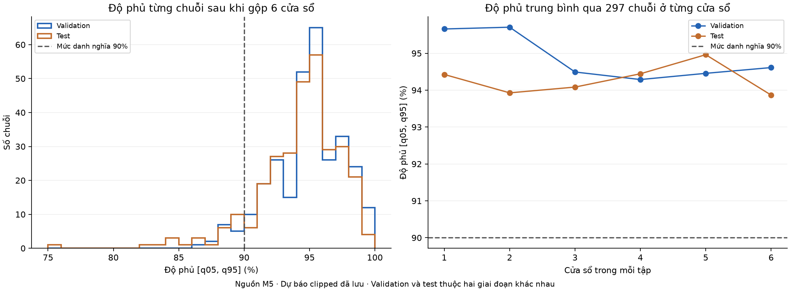

# Tuần 4, mục 5 — Khoảng danh nghĩa 90% phủ bao nhiêu ngày?

## Kết quả chính

Khoảng `[q05, q95]` có độ phủ trung bình **94,869328% trên validation** và
**94,285002% trên test**. So với mức danh nghĩa 90%, hai mức chênh lần lượt
là **+4,869328** và **+4,285002 điểm phần trăm**. Đây là kết quả đo từ M5,
không phải số giả định. Không đặt thêm ngưỡng tùy ý để gọi kết quả là “đạt”.

Độ phủ cao hơn 90% ở mức gộp, nhưng có **15/297 chuỗi validation** và
**27/297 chuỗi test** dưới 90%. Vì vậy, kết quả gộp chưa bảo đảm từng sản
phẩm được phủ tương đương nhau. Chuỗi là một cặp sản phẩm–cửa hàng.

Nguồn đã hoàn tất và đối chiếu CSV/MLflow:

- Validation: `6677b9628294457fb1a3df04056875d1`, d_1606–d_1773.
- Test: `6bb24de09d644f58bbaa63ab0a608ad2`, d_1774–d_1941.
- Mỗi tập có sáu cửa sổ; giữ nguyên cấu hình khi chuyển từ validation sang
  test. Phân tích này đọc kết quả đã lưu, không huấn luyện hoặc chỉnh mô hình.

## Cách tính và mẫu số

Giữ cách gộp của mục 3: tính từng chuỗi/cửa sổ, lấy trung bình sáu cửa sổ
trong từng chuỗi rồi trung bình đều qua 297 chuỗi. Bản chính là **clipped**:
đặt dự báo âm về 0, không sắp xếp lại các phân vị bị đảo thứ tự.

Validation chấm 49.896 quan sát, trong đó 47.336 nằm trong khoảng. Tỷ lệ
gộp trực tiếp cũng là 94,869328% vì mọi cửa sổ có cùng mẫu số.

Test lưu 49.896 dự báo nhưng chấm 49.599 quan sát sau khi loại d_1792
(25/12/2015) theo **giả định đóng cửa đã dùng từ trước**. Có 46.764 quan
sát nằm trong khoảng. Tỷ lệ gộp trực tiếp là **94,284159%**, hơi khác
94,285002% ở trên: cách gộp chính cho cửa sổ 27 ngày trọng số bằng cửa sổ
28 ngày. Hai số dùng mẫu số và trọng số khác nhau, không phải lỗi làm tròn.

## Vì sao có thể phủ hơn 90%?

Ở cả hai tập, q05 trong dự báo clipped bằng 0 ở toàn bộ 49.896 dòng.
Số bán không âm nên không có ngày nằm dưới đầu dưới; khoảng thực tế là
`[0, q95]`. Do đó, độ phủ khoảng bằng tỷ lệ `sales <= q95`.

Với dữ liệu rời rạc và nhiều số 0, một phân vị có thể trùng đúng giá trị
mà rất nhiều quan sát cùng nhận. Tính cả đầu mút có thể khiến độ phủ của
khoảng vượt mức danh nghĩa dù phân vị vẫn hợp lý. Trong kết quả này,
tỷ lệ `sales <= q05` trung bình là **49,707391% trên validation** và
**45,137070% trên test**, trong khi tỷ lệ `sales < q05` bằng 0.
Đó là lý do cụ thể cần xét số 0 và giá trị trùng đầu mút khi đọc kết quả.

Tuy nhiên, không kết luận mọi q05 đều phù hợp: **10 chuỗi validation** và
**13 chuỗi test** có tỷ lệ `sales <= q05` dưới 5% theo cách gộp đã chọn.
Đây là mô tả thực nghiệm, chưa phải kiểm định thống kê.

Đọc thêm từng đầu mút: trên test, tỷ lệ `sales <= q90` là **89,205696%**,
và `sales <= q95` là **94,285002%**. Hai ngưỡng trên phủ hơi thấp hơn mức
90% và 95% tương ứng, trong khi khoảng `[q05, q95]` vẫn phủ hơn 90%.
Độ phủ cao của cả khoảng vì thế chưa chứng minh từng phân vị đều khớp
mức xác suất mục tiêu. Với q50 test, tỷ lệ `sales < q50` là 57,182866% và
`sales <= q50` là 58,252499%; mức 50% nằm dưới cả hai tỷ lệ gộp này,
gợi ý q50 đang dự báo cao ở mức gộp. Chưa suy ra kết luận cho từng chuỗi.

## Khác biệt giữa chuỗi, cửa sổ và mức bán

Độ phủ từng chuỗi validation nằm trong **86,309524%–100%**. Chuỗi thấp
nhất là `FOODS_3_797_WI_1_evaluation`, cũng là ví dụ chẩn đoán đã vẽ ở mục 4.
Trên test, khoảng biến thiên là **75,970018%–100%**; chuỗi thấp nhất là
`FOODS_3_120_TX_2_evaluation`. Đây là các trường hợp tìm sau khi xem kết
quả để chẩn đoán, không dùng để chọn lại cấu hình theo test.

Độ phủ trung bình từng cửa sổ validation dao động **94,288119%–95,707071%**;
test là **93,867244%–94,961520%**. Mọi cửa sổ có trung bình trên 90%,
nhưng điều đó vẫn che được những chuỗi có độ phủ thấp.

Để xem mức bán, dùng số bán trung bình **chỉ trên train**, từ ngày bán
dương đầu tiên và loại ngày đóng cửa theo cùng quy tắc của mục 4. Sắp
297 chuỗi theo trung bình này, phá hòa bằng id rồi chia ba nhóm, mỗi
nhóm 99 chuỗi. Đây là **quy ước mô tả tự chọn**, không phải phân hạng
nghiệp vụ và không dùng các mức bán đã chọn bằng toàn bộ giai đoạn.

- Nhóm thấp: độ phủ validation **94,715007%**, test **93,979923%**;
  độ rộng test trung bình **2,094795 đơn vị hàng**.
- Nhóm giữa: độ phủ validation **94,618807%**, test **94,409037%**;
  độ rộng test **4,108121 đơn vị hàng**.
- Nhóm cao: độ phủ validation **95,274170%**, test **94,466045%**;
  độ rộng test **12,235641 đơn vị hàng**.

Độ phủ ba nhóm không chênh nhiều ở mức gộp, trong khi độ rộng tuyệt đối
tăng rõ ở nhóm bán nhiều. Độ rộng toàn bộ chuỗi là **6,048985 đơn vị**
trên validation và **6,146186 đơn vị** trên test. Độ rộng dùng đơn vị hàng,
không phải phần trăm; chưa có baseline khoảng để kết luận khoảng đã hẹp
hoặc hiệu quả hơn phương pháp khác.

## Bước dự báo và thứ tự phân vị

Theo bước dự báo 1–28, lấy trung bình đều qua các cửa sổ có độ phủ xác định.
Trên validation, độ phủ nằm trong **93,434343%–96,071829%**; test là
**92,929293%–96,184063%**. Bước 19 ở test chỉ có năm cửa sổ được chấm vì
cửa sổ đầu trùng ngày đóng cửa; CSV giữ số cửa sổ và số quan sát để thấy
mẫu số này. Không coi sáu điểm cùng bước là mẫu đủ để kiểm định độ tin cậy.

Độ rộng trung bình ở bước 1 và 28 lần lượt là **5,655227 → 7,079119 đơn vị**
trên validation, **5,740539 → 6,966916 đơn vị** trên test. Hai đầu mốc cho
thấy khoảng ở bước 28 rộng hơn bước 1, nhưng chưa chứng minh độ rộng tăng
đều theo từng bước. Độ phủ cũng không giảm đều theo bước dự báo.

Tỷ lệ có ít nhất một cặp phân vị liền kề sai thứ tự là **4,753888%** trên
validation và **3,486585%** trên test. Tỷ lệ q05 > q95 của bản clipped bằng
0 nên khoảng ngoài vẫn có đầu mút đúng thứ tự. Vẫn cần lưu nhận xét về
crossing trước khi dùng đồng thời các phân vị trong cách đặt hàng.

## Kết luận dùng trong báo cáo

> Khoảng dự báo danh nghĩa 90% của LightGBM đạt độ phủ trung bình 94,87%
> trên validation và 94,29% trên test theo cách gộp đều qua cửa sổ và chuỗi.
> Đầu dưới q05 sau clipping đều bằng 0; tính rời rạc và nhiều ngày số bán
> bằng 0 giúp giải thích việc độ phủ của khoảng cao hơn mức danh nghĩa.
> Tuy nhiên, 27/297 chuỗi test có độ phủ dưới 90%, và các ngưỡng trên q90,
> q95 có độ phủ gộp hơi thấp hơn mức mục tiêu riêng. Cần đọc cùng độ rộng,
> pinball loss và crossing, thay vì kết luận mô hình đã được hiệu chỉnh tốt
> từ một số coverage trung bình. Những kết quả này chưa cho biết chi phí
> tồn kho hoặc tỷ lệ lượng hàng khách cần được đáp ứng.

Các ngày và chuỗi có thể liên quan nhau; đây là phân tích mô tả, chưa có
khoảng tin cậy hoặc kiểm định khác biệt giữa hai giai đoạn. Giữ nguyên
giả định doanh số đại diện cho nhu cầu và các giới hạn chọn tập con đã
ghi ở `docs/assumptions.md`. Không chỉnh lại mô hình bằng điểm test này.

## Tái tạo và tệp kết quả

```powershell
python -m src.evaluation.analyze_coverage --validation-run-id 6677b9628294457fb1a3df04056875d1 --test-run-id 6bb24de09d644f58bbaa63ab0a608ad2
```

Cần các CSV kết quả nguồn, hai parquet tập con và cấu hình chia thời gian
trong repo. Lệnh ghi kết quả vào
`reports/quantiles/coverage/6bb24de09d644f58bbaa63ab0a608ad2/`:

- `overall.csv`: mẫu số, số được phủ, macro/pooled coverage, số chuỗi dưới 90%.
- `per_window.csv`, `per_horizon.csv`, `per_quantile.csv`: chẩn đoán theo từng chiều.
- `per_series.csv`, `per_volume_group.csv`, `training_volume_groups.csv`: từng chuỗi và nhóm train.
- `provenance.json`: run nguồn, quy ước và SHA-256 của tệp đầu vào.
- `coverage_diagnostics.png`: phân bố độ phủ và biến thiên giữa cửa sổ.



Mục 5 đã hoàn tất: người thực hiện chạy lại lệnh trên, gửi output khớp
kết quả và xác nhận chuyển tiếp. [Bản tóm tắt Mốc 1](milestone1_summary.md)
đã được chuẩn bị cùng [báo cáo tuần 4](week4_quantiles.md).
